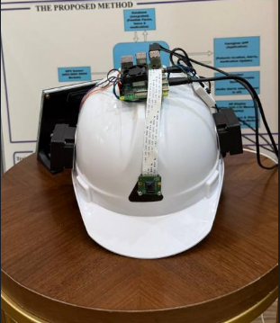
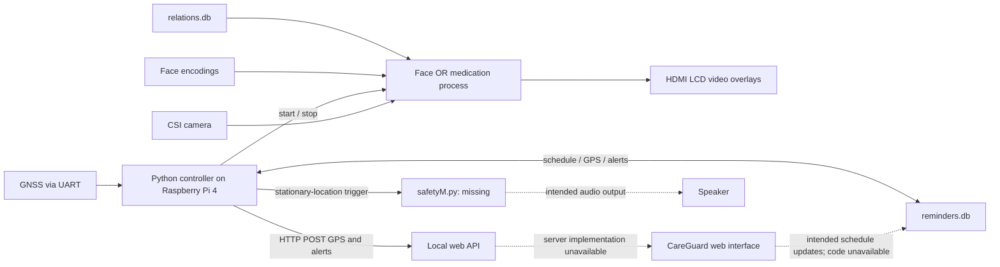
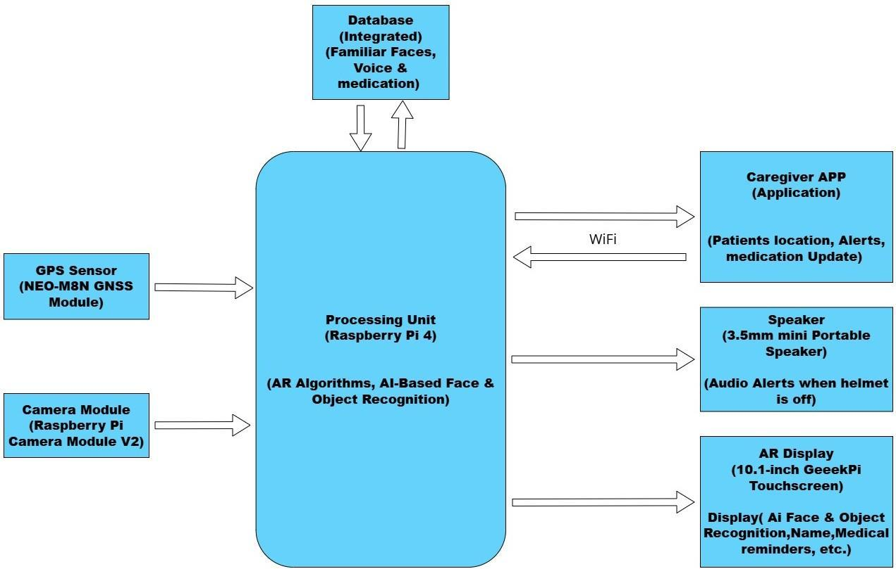
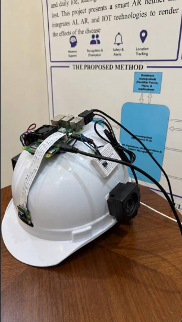
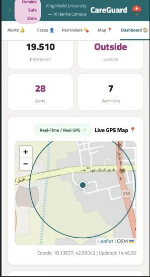
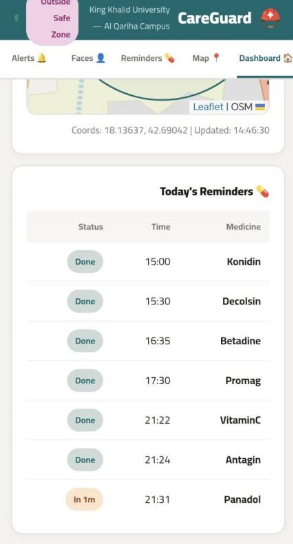
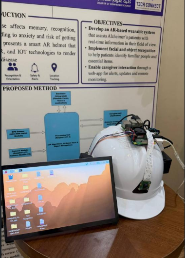
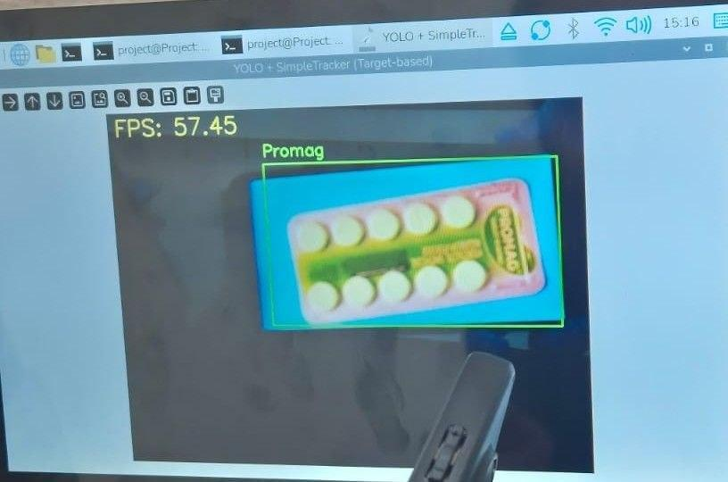

# AR Helmet for Alzheimer's Patients

**Graduation Engineering Prototype · Computer Engineering · King Khalid University**

A Computer Engineering graduation project that brings **hardware, embedded software, computer vision, GPS, databases, and a caregiver web application** together in a physical helmet prototype. Built collaboratively at King Khalid University, the system combines local recognition and medication reminders with location processing and the CareGuard interface.

The central engineering achievement was integrating these components into a working prototype: assembling the hardware, adapting software modules, connecting data flows, and testing their interaction. This portfolio presents that system-level work, with report evidence distinguishing demonstrated behavior from intended capabilities. **It is an experimental graduation prototype without clinical validation; the available source is partial.**

*Original project photograph; the poster's personal-details section has been cropped out. The report photograph from PDF p.54 remains available in the [asset inventory](assets/README.md). All page references in this repository count the cover as PDF page 1.*

## Problem and proposed solution

People living with Alzheimer's disease may experience difficulty recognizing familiar people, remembering medication schedules, and maintaining orientation. The proposed helmet combines a camera, local processing, a display, GPS, and audio hardware with a caregiver interface to explore support for these tasks.

The demonstrated display presents labels and information over camera video on an HDMI LCD. The original project name uses “AR”; the report does not establish optical see-through hardware, spatial tracking, or a fully realized wearable AR optical system.

## Capabilities and evidence

| Capability | Status supported by the report |
| --- | --- |
| Familiar-face recognition and profile overlays | Code excerpts and prototype screenshots; both correct and incorrect identification documented |
| Medication-package detection | YOLO/ONNX excerpts and live demonstration images; false detections documented |
| Scheduled switching between recognition modes | Present in the appendix controller; the two recognition processes alternate |
| GPS parsing and geofencing | Wiring and controller logic available; independent field-performance evidence missing |
| SQLite persistence and HTTP integration | Controller creates tables and sends GPS/alert payloads; server source unavailable |
| CareGuard dashboard | Screenshot documents map and reminder presentation; complete application source unavailable |
| Audio safety mechanism | Speaker hardware and external safety-script invocation documented; script/audio missing |
| Automatic helmet-removal detection | Intended feature; no direct removal sensor or verified detection demonstrated |

## System architecture

Solid arrows describe code or hardware paths documented in the report. Dashed arrows describe integration whose implementation cannot be inspected. The original diagram below captures the intended system, including capabilities with incomplete evidence.

See [architecture](docs/architecture.md) for the process lifecycle, data contracts, and differences between the report's diagrams and appendix code.

## Hardware

| Component | Role |
| --- | --- |
| Raspberry Pi 4 Model B | Central controller, local vision processing, and integration |
| Raspberry Pi Camera Module V2 | Camera input through CSI |
| NEO-M8N GNSS module | Location input through UART |
| GeeekPi 10.1-inch touchscreen | HDMI video and information display |
| USB / 3.5 mm speaker | Intended audio feedback |
| Belkin 10000 mAh power bank | Portable Pi power through USB-C |
| Cooling fan, GPIO push button, helmet, cables | Cooling, shutdown input, and physical integration |

*Side view of the actual prototype, showing component mounting, the camera ribbon cable, wiring, and a speaker.*

The report does not establish final RAM capacity, measured battery runtime, thermal performance, or helmet weight. [Hardware documentation](docs/hardware.md) records the available connections without presenting them as independently verified assembly instructions.

## Software and AI

- **Embedded environment:** Raspberry Pi OS 64-bit, Python 3, virtual environments, Thonny.
- **Vision:** Picamera2, OpenCV, NumPy, `face_recognition`/dlib HOG detection and 128-dimensional face embeddings.
- **Medication detection:** Ultralytics YOLOv8n training/export, ONNX Runtime inference, NMS, and reported SORT tracking.
- **Integration:** SQLite, `requests`, `subprocess`, `threading`, `pyserial`, and `pynmea2`.
- **Web evidence:** CareGuard dashboard screenshot, Leaflet/OSM attribution, and controller-side HTTP calls. The backend framework is not established.

Flutter, Edge Impulse, TensorFlow Lite, GPSD, and Pygame Mixer appear in initial requirements but are not confirmed as the final implementation. See [software stack](docs/software-stack.md).

## CareGuard and system integration

The report's CareGuard screenshot shows a map, scheduled medicines, status labels, and navigation for Dashboard, Map, Reminders, Faces, and Alerts. The controller stores records locally and sends JSON to `/api/gps` and `/api/alert` at a configured local web service.

CareGuard provides the caregiver-facing information layer of the project. Its complete implementation and remote-access setup remain unavailable for independent review. A displayed “Done” status is not evidence that medication was taken.

*CareGuard dashboard showing the GPS map, location status, and alert/reminder counts. The owner confirms that the displayed location and coordinates are arbitrary demonstration data, not a real user's private location; this screenshot is not an independent GPS-performance test.*

*CareGuard medication schedule with displayed times and status labels. The location information is demonstration data, as confirmed by the owner.*

These original application screenshots were supplied separately from the report. Face demonstrations remain withheld because they show identifiable subjects and personal information. See the [asset inventory](assets/README.md) and [web application documentation](docs/web-application.md).

## Engineering workflow

The documented workflow spans design-alternative evaluation, component selection and wiring, local model preparation, deployment to Raspberry Pi environments, database integration, process orchestration, and prototype testing.

The controller starts face recognition, checks the reminder schedule, stops the face process when a reminder becomes due, launches medication detection with a target name, and then returns to face recognition. GPS monitoring and alert logging run alongside this control loop. This demonstrates integration across hardware interfaces, operating-system processes, persistent storage, and HTTP communication.

*The helmet and connected external display during the project demonstration. The screen shows the Raspberry Pi desktop, rather than a recognition result.*

## Demonstration and evaluation

*Original report image, PDF p.61. The on-screen FPS counter is not a verified end-to-end inference benchmark.*

The report describes **38 test cases**, comprising 18 face-recognition cases and 20 medication-detection cases. These are test cases, not a clinical participant count.

| Reported metric | Face recognition | Medication detection |
| --- | ---: | ---: |
| Precision | 62.5% | 75.0% |
| Recall | 100.0% | 92.3% |
| Specificity | 25.0% | 42.9% |
| Accuracy | 66.7% | 75.0% |
| F1, as printed | 76.9% | 82.7% |

False positives are a significant limitation. Medication F1 recalculates to approximately 82.76% from the reported counts, or 82.8% rounded to one decimal place. The report's 54–72 FPS claim lacks a reproducible timing method and does not establish throughput across both modules. See [evaluation](docs/evaluation.md) for counts, context, and evidence limits.

## My contributions

- **CareGuard development:** developed the web application by defining requirements and features, directing AI-assisted implementation through prompts, and iteratively refining the generated application.
- **Software integration:** adapted and integrated modules provided by teammates, including face recognition code, using AI-assisted workflows to connect them with the broader system and CareGuard.
- **Hardware assembly:** helped assemble the physical helmet, connect components and peripherals, wire the necessary connections, and set up portable power through a power bank.
- **Raspberry Pi collaboration:** shared the prepared and integrated code with a teammate, who transferred and ran it on the Raspberry Pi connected to the development laptop. We collaborated to make the software work with the physical prototype and CareGuard.
- **Testing and teamwork:** participated in integrated testing, troubleshooting, and functionality refinement while exchanging code, communicating requirements, and resolving technical challenges with teammates.

These responsibilities are my account of the project work. Original software development and Raspberry Pi deployment were shared across the team. See [my contributions](docs/my-contributions.md) for the detailed scope and attribution.

## Teamwork and engineering skills

The project connects embedded Linux and CSI/UART/GPIO/HDMI interfaces with computer vision, SQL persistence, local HTTP communication, and process management. My work developed practical skills in **requirements definition and AI-assisted development** through CareGuard, **software and hardware integration** through module adaptation and assembly, and **testing and troubleshooting** through integrated prototype checks.

Code exchanges, requirements discussions, and joint troubleshooting made teamwork and communication part of the engineering workflow. For Computer Engineering and infrastructure-oriented roles, the project offers concrete examples of device-to-application integration and collaborative problem-solving at prototype scale.

## Source availability and reproducibility

This repository documents the completed academic prototype through technical documentation, original project photographs, selected report images, a controller transcription, and original code-excerpt images. **Extracted project code has not been executed, tested, or verified to operate.**

The controller's site coordinates have been replaced with explicitly documented placeholders. Complete vision modules, CareGuard source, the safety script, model weights, datasets, private databases, and dependency versions are missing, so this repository does not provide a reproducible installation guide.

- [Source inventory and provenance](docs/source-inventory.md)
- [Controller transcription notes](source/README.md)
- [Technical limitations and privacy](docs/limitations.md)

**Status: Completed Graduation Engineering Prototype — not production-ready or clinically validated.** The original unredacted report remains local and is excluded by `.gitignore`. No license is assigned. Public release of team-authored source and code-excerpt images is blocked until redistribution permission is confirmed.
