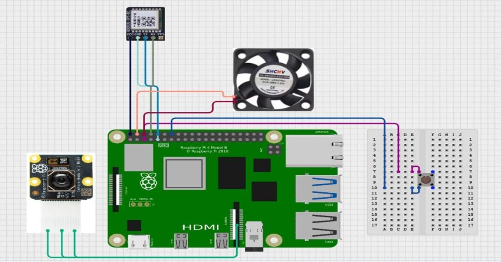

# Hardware integration

Sources: PDF pp.25–26, 29–32, 43–47, and 54. Connections below are report evidence, not independently validated wiring instructions.

| Hardware | Responsibility | Reported connection |
| --- | --- | --- |
| Raspberry Pi 4 Model B | Local processing and system control | Central board; RAM unspecified |
| Camera Module V2, nominal 8 MP | Image capture | CSI ribbon cable |
| NEO-M8N GNSS | Location acquisition | UART, GPS TX to Pi GPIO15/RX and GPS RX to GPIO14/TX; report specifies 5 V supply and GND |
| GeeekPi 10.1-inch touchscreen | Video overlay display | HDMI and USB power |
| Compact speaker | Intended safety audio | USB and 3.5 mm audio jack |
| Belkin 10000 mAh power bank | Portable power | Pi USB-C |
| Cooling fan | Thermal management | 5 V and GND |
| Momentary button | Shutdown input | GPIO3 and GND, small breadboard |
| Helmet and mounting/cabling | Physical integration | Photographed prototype assembly |

The firmware screenshot on PDF p.44 shows UART enablement and a GPIO shutdown overlay. The prose on p.43 contains different parameter spelling; use the original device configuration and verify it before any future reconstruction.

The exact GNSS breakout revision and signal-level compatibility need verification before reproducing the wiring. There are no fabrication drawings, measured mounting loads, helmet weight, battery runtime, current consumption, or thermal logs. The display demonstrates camera overlays; a see-through optical assembly is not documented.

The setup text describes microSD storage, but an Imager screenshot shows an SSK external storage device. The final storage arrangement is unresolved. GPIO numbering above follows the report's GPIO names rather than physical header-pin numbers.

The historical cost table totals **1058–1158 SAR**. It is an estimate from the report, not a current quote or a verified final bill of materials. ESP32, ESP32-CAM, and cloud processing belong to the rejected alternative and are not included in the implemented hardware list.
